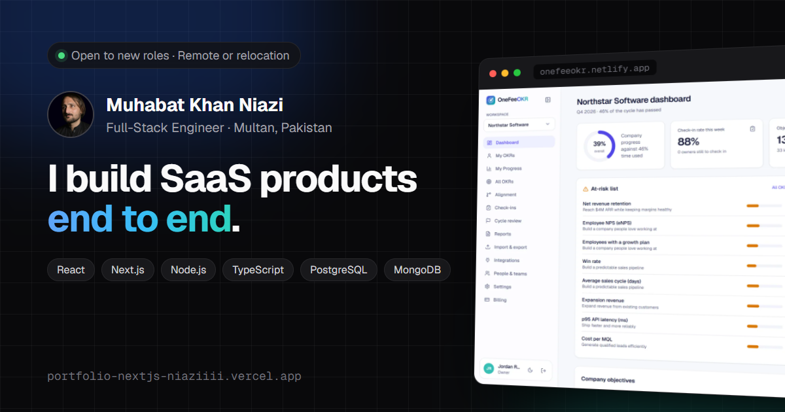

# Muhabat Khan Niazi · Portfolio

Personal site of Muhabat Khan Niazi, full-stack engineer (React, Next.js, Node.js, TypeScript).

**Live:** https://portfolio-nextjs-niaziiii.vercel.app



## What's inside

- Case studies with real screenshots: [OneFeeOKR](https://portfolio-nextjs-niaziiii.vercel.app/projects/onefeeokr) (solo-built OKR SaaS) and [Stackly](https://portfolio-nextjs-niaziiii.vercel.app/projects/stackly) (agency platform with a GrapesJS page and funnel builder and AI generation)
- Experience timeline, skills, contact, and three downloadable résumés (full-stack, frontend, backend)
- Light and dark themes with no flash on load, scroll reveals that respect reduced motion, and a keyboard-accessible screenshot lightbox
- Static pages only: every route is prerendered, with no database or API to keep running
- SEO: per-page metadata, Open Graph image, JSON-LD `Person` schema, `sitemap.xml` and `robots.txt`

## Stack

Next.js 16 (App Router) · React 19 · TypeScript · Tailwind CSS v4 · react-icons · Vercel

## Editing content

All content lives in typed files under `src/data/`:

| File | What it holds |
|---|---|
| `site.ts` | Name, role, contact links, availability, résumé paths |
| `experience.ts` | Roles, education, certifications, languages |
| `projects.ts` | Case studies: summary, highlights, stats, decisions, screenshot gallery |
| `skills.tsx` | Skill groups and icons |

Screenshots live in `public/projects/<slug>/` (WebP, about 1600px wide). Résumé PDFs live in `public/resume/` and are generated from `../job/documents/resumes/source`.

## Getting started

```bash
npm install
npm run dev      # http://localhost:3000
npm run build    # production build
```
